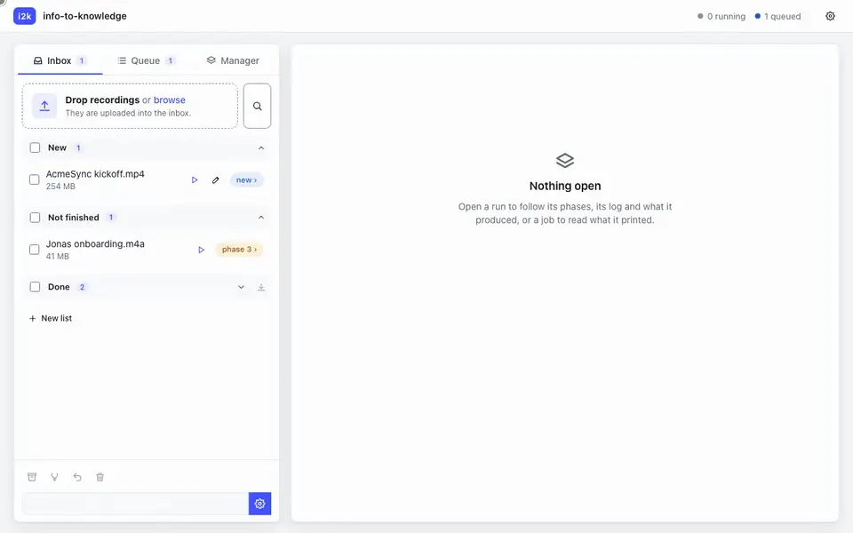
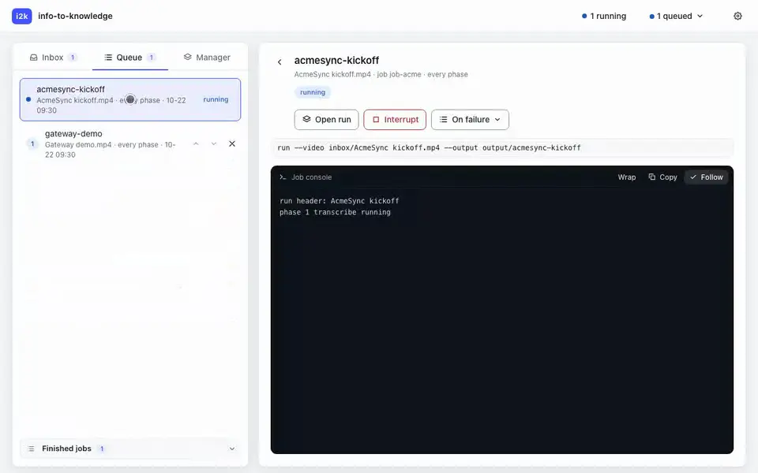
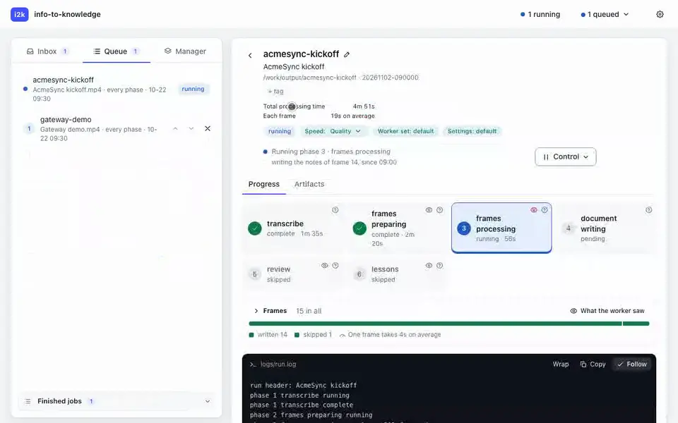
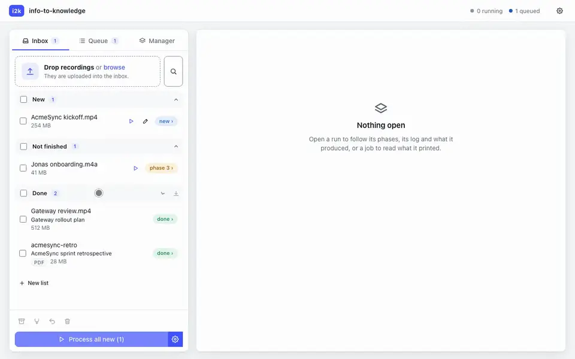

# info-to-knowledge

info-to-knowledge turns a video, an audio recording, a PDF, a Word file or a slide deck into a Markdown document
that holds its knowledge.

The document is made to be read and reused: put it in an AI wiki or a notes vault, search it, or hand it to a model
as a short and exact source in place of hours of recording. It opens with an executive summary and an agenda, its
chapters follow the recording's own parts, and every statement names the minute or the page it comes from.
Everything runs on your own computer against a local model host such as LM Studio or Ollama.

## Use cases

- **A long video you have no time for.** Download a talk or a lesson from YouTube and read its knowledge in a
  fraction of the time. The chit-chat and the off-topic parts stay out, and the screens that teach something come
  back as cut screenshots, code blocks, tables and diagrams.
- **A team meeting nobody wrote down.** The decisions, the action items and the open questions get their own
  sections. The video gallery of the people in the call is cut away from every screenshot, and a password, a token
  or a customer number shown on a shared screen is blacked out.
- **A pile of PDFs, Word files and slide decks.** Each one becomes Markdown in the same shape, ready for a wiki, a
  search index or a model's context.
- **Knowledge compacted for a model.** The document keeps every point the recording makes in a fraction of its
  words, so an agent reads the document instead of a transcript.
- **The same knowledge as a new video, in your style.** Give the document to the sister project Media Vibe Studio
  with `mvs run --document`, and ask in its request for the video you want: denser, more entertaining, or with more
  diagrams.

## What it looks like

The clips show the web page with invented recordings and a made-up document.

**Queue a recording.** Start a run from the inbox, find it in the queue, and move it ahead of the job waiting
there.



**Follow a run.** Each phase card fills in as the run goes, the frames bar counts the frames written and skipped,
and the log scrolls beside it.



**Pause and continue.** The Control menu holds a run at its next check, and Continue lets it go on from the same
place.



**Read the document.** A finished run opens its Markdown document in the page, with tables, diagrams and the
minute each statement comes from.



## What it does with a recording

- **Finds the frames that matter.** For a video, the program takes a frame whenever the shared screen changes and
  holds still, crops it to the shared screen, and drops people galleries, blank screens and repeats. A vision model
  then writes each kept frame's notes.
- **Writes the screen as text.** Code, terminal output, tables and lists become Markdown, and a frame is kept as a
  picture only where text cannot carry it.
- **Hides what should not be published.** The people beside a shared screen are cropped out, and a secret, a
  credential or personal data on a screenshot is blacked out before the document is published.
- **Checks every answer.** A validator reads what the model wrote and rejects a bad answer with the reason, and the
  model tries again. A step that spends all its attempts stops the run with a clear message, and `--resume`
  continues it.
- **Reviews the result.** A second worker reads the finished document as a critic and fixes what the recording can
  answer.
- **Fits the recording.** A meeting, a conversation, a presentation, a language lesson and sprint notes each get
  their own document shape.

A web page and a terminal UI queue recordings, show each run's phases, frames and log, and pause, resume or reset a
run.

## Requirements

- Python 3.12, FFmpeg, Node.js 22 and Tesseract (with the English and German language data).
- Pandoc, for Word, PowerPoint and OpenDocument files.
- A model host with a vision-capable model. The default settings name `qwen3.6-35b-a3b-mtp` in LM Studio at
  `http://localhost:1234/v1`.
- Disk space for the models. Check your free disk first: the recommended language model is about 19 GB.

On an Apple silicon Mac the program also uses MLX for speech recognition and Apple's text recognizer. On Linux and in a
container it uses faster-whisper and Tesseract instead (`--profile container`).

## Install

```bash
python3.12 -m venv .venv
.venv/bin/python -m pip install -e .         # installs the packages of requirements.txt and the `i2k` command
source .venv/bin/activate
(cd web && npm ci && npm run build)          # the web page
export HF_TOKEN=hf_...                       # a Hugging Face token, only for gated models such as the speaker model
i2k setup-models                             # downloads the recommended models into models/ (git-ignored)
i2k probe                                    # checks that every configured model host answers
```

`./setup.sh hf_...` does the same steps in one script. To run in a container, read
[docs/container.md](docs/container.md).

Speaker recognition (who spoke when) is optional: `pip install -r requirements-diarization.txt`, then accept the terms
of the model on huggingface.co with the account of your token.

## First run

```bash
i2k run --video ~/Downloads/talk.mp4 --output output/talk
```

`--output` is the run folder itself. The finished document lands there in a folder named after the recording, with
its screenshots beside it. Pass `--resume` to continue a stopped run. Other ways to start:

```bash
i2k run --video report.pdf --output output/report                # a PDF, a Word file or a slide deck the same way
i2k run --video notes.mp3 --output output/notes --ingesting-profile meeting
i2k inbox                                 # run every new recording in inbox/
i2k run --video talk.mp4 --output output/talk --from 4           # write the document again from the frames' notes
i2k serve                                 # the web page at http://127.0.0.1:8765
```

## Settings

`playbook.default.json` holds the default settings. Copy `playbook.local.example.json` to `playbook.local.json` for
the values of your machine. The program reads the local file on top of the default file, and git ignores it. A key
or a password never goes in a settings file: the settings name an environment variable, or the program reads
`HF_TOKEN` from the environment.

## Documentation

- [Architecture](docs/ARCHITECTURE.md): the phases, the run folder and the code layers.
- [Flow](docs/FLOW.md): what each phase reads and writes, file by file.
- [Command line](docs/cli-usage.md) and [web page](docs/ui-usage.md).
- [Full guide](docs/GUIDE.md): install, every run option, the settings and troubleshooting.
- [Workflow](docs/WORKFLOW.md), and how the [command line](docs/cli-context.md) and the [web page](docs/ui-context.md) are built.
- [Running in a container](docs/container.md).
- [Third-party models and data](NOTICE).

## Tests

```bash
.venv/bin/python tests/run_tests.py                    # the offline suite, no model host needed
.venv/bin/python tests/run_tests.py test_ui_services   # one case file
(cd web && npm test)                                   # the web page's unit tests
```

## Contributing

Bug reports, ideas and pull requests are welcome. Read [CONTRIBUTING.md](CONTRIBUTING.md) first and follow the
[Code of Conduct](CODE_OF_CONDUCT.md). Report a security problem as [SECURITY.md](SECURITY.md) says.

## License

info-to-knowledge is free software under the [GNU Affero General Public License v3.0](LICENSE). You may use, change
and share it. If you share a changed version, or run one as a service for others, you must publish its source code
under the same license.

The models, word lists and helper tools it uses have their own licenses: see [NOTICE](NOTICE).
