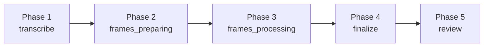
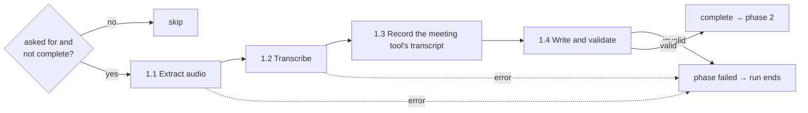
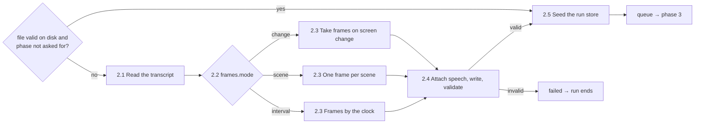
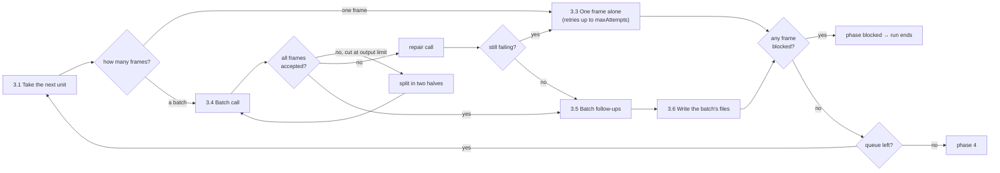
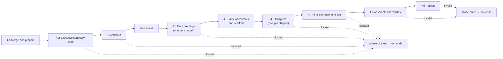
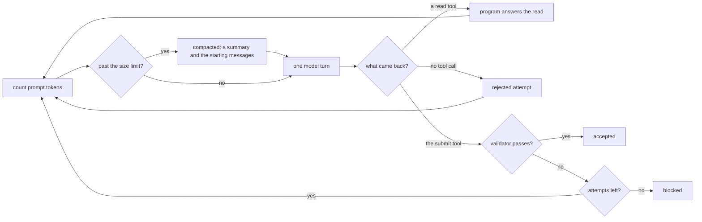
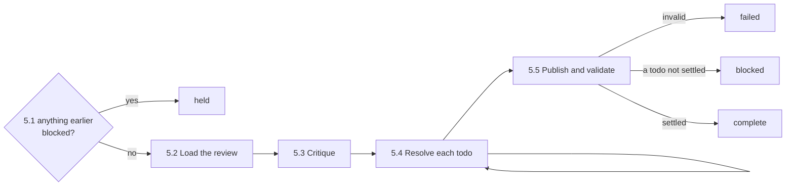

# Workflow: from a recording to a reviewed document

Process → Phase → Stage → Step, traced from the code on 2026-09-29 (`src/graph/graph_assembly.py`, `src/graph/routing.py`
and the five nodes under `src/graph/nodes/`). `FLOW.md` lists what each phase reads and writes; this file shows the order of
the work and who does each step.

**Actors**

- ⚙️ **Program**: the playbook's own code, deterministic.
- 🤖 **Agent**: the local language model, role `frame` in phase 3 and role `document` in phases 4 and 5.
- 🔧 **Tool**: a speech recogniser, OpenCV, the face detector, or a tool the agent calls (`read_notes`, `look`, `cut`, ...).
- 👤 **Human**: the operator at the command line.
- 🗄️ **System**: the run folder on disk and the run store (`logs/*/run.json`).

---

## 1. Process overview

**Rules that hold for every phase** (from `routing.py` and each node's first step):

- 👤 The operator picks which phases run (`--phase`, `--from`, `--resume`, `--dry-run`). A phase not asked for is read from
  its file on disk; a missing file is refused by name.
- A phase already `complete` in the run store is skipped on a resume.
- A failed phase 1 or 2 ends the run. A blocked frame in phase 3 ends the run. A blocked or failed phase 4 ends the run.
- A dry run renders the message a model would be sent, and calls no model.

---

## Phase 1 — Transcribe

Turns the recording's speech into timed text. Plain code, no language model, no retry: a transcription that failed would
fail the same way again.

### Stage 1.1 — Extract audio

| Step | Actor | Action | Details |
|---|---|---|---|
| 1 | ⚙️ Program | Check the phase is asked for, not complete, not a dry run | Otherwise the node returns `complete` and does nothing |
| 2 | 🔧 Tool | Extract the audio track | `audio_extraction_service.extract_audio` writes `audio.wav`; returns nothing when the video has no audio stream. A folder of parts: each part's audio (`audio-part-NN.wav`) is transcribed, its times moved on by the parts before it, and the parts joined into one transcript |

### Stage 1.2 — Transcribe

| Step | Actor | Action | Details |
|---|---|---|---|
| 1 | 🔧 Tool | Recognise the speech | `transcription_service.produce_transcript`; segments and words each carry a time. `FLOW.md` names mlx-whisper large-v3-turbo; a faster-whisper client also exists. Which one runs depends on `playbook.local.json` (not checked here) |
| 2 | ⚙️ Program | Use an empty transcript when there is no audio | `hasAudio: false`, no segments |
| 3 | ⚙️ Program | Catch any error | The phase is marked `failed`; the run ends |

### Stage 1.3 — Record the meeting tool's transcript

| Step | Actor | Action | Details |
|---|---|---|---|
| 1 | ⚙️ Program | Look for a transcript file beside the recording | `provided_transcript_service`; records its size, how far it agrees with phase 1, and the speakers it names. It never replaces phase 1's text (R14) |

### Stage 1.4 — Write and validate

| Step | Actor | Action | Details |
|---|---|---|---|
| 1 | 🗄️ System | Write `01_transcript.json` | |
| 2 | ⚙️ Program | Validate the file from disk | Invalid: phase `failed`, run ends. Valid: phase `complete` |

---

## Phase 2 — Enumerate

Cuts the frames the model will read and gives each one the speech around it. Plain code, no language model, no retry. Its
failure ends the run, because every later phase is built on the frame list.

### Stage 2.1 — Read the transcript

| Step | Actor | Action | Details |
|---|---|---|---|
| 1 | ⚙️ Program | Decide whether the frame list is needed at all | Not needed when neither phase 2 nor phase 3 is asked for |
| 2 | ⚙️ Program | Read `01_transcript.json` | Refused by name when missing |

### Stage 2.2 — Choose the mode

| Step | Actor | Action | Details |
|---|---|---|---|
| 1 | ⚙️ Program | Open the video and read its length and frame rate | `frame_extraction_service._open_video`, through `recording_parts_service.open_recording`: a folder of parts is one video, frame numbers running on |
| 2 | ⚙️ Program | Branch on `frames.mode` | `change` (this machine's setting), `scene`, or `interval` (the shipped default) |

### Stage 2.3 — Take the frames (`change` mode shown in full)

| Step | Actor | Action | Details |
|---|---|---|---|
| 1 | 🔧 Tool | Sample the video once a second | OpenCV |
| 2 | ⚙️ Program | Find the shared screen: black stage connected to the frame's edge | Pixel rule, values below 4; looked for every `frames.boxEverySeconds` (5), and every second while a new box waits; the box changes only after two checks in a row agree |
| 3 | 🔧 Tool | Find a column or row of at least two faces packed against the screen, and cut it | YuNet face detector from `weights/`; a gallery of faces with no screen is never taken |
| 4 | ⚙️ Program | Compare with the last frame taken, in 32 by 18 blocks | Take a frame once 5% of blocks changed and the screen held still 1 s, or kept moving 10 s |
| 5 | ⚙️ Program | Mark a return to an earlier screen as `repeatOf` that frame | `change_capture_utils.find_repeat`: the new frame against every frame taken before, in 32 by 18 blocks of a small grey copy; under 1% of blocks changed against the closest is a repeat. Its time ends the frame before's speech, so what is said while the screen is back stays with that moment |
| 6 | ⚙️ Program | Drop a repeat on screen under `frames.passThroughSeconds` (5) | A pass-through: slides flicked past, windows switched (`_drop_pass_throughs`); a repeat of a dropped frame repeats what that one repeated |
| 7 | ⚙️ Program | Keep at most `frames.maxCount` frames, the most changed | `_keep_most_changed` |
| 7b | ⚙️ Program | Mark the steps of a slide built up step by step | A frame that follows the one before it and changed by at most `frames.buildStepChange` (15%), or repeats that build right after it, is `stepOf` the build's first frame (`_mark_build_steps`) |
| 8 | ⚙️ Program | Cut the bars inside the screen | Edge rows and columns that stay the same across up to 10 frames either side (`frames.trimBars`) |
| 9 | 🗄️ System | Write `frames/frame-NNN.jpg` | No wider than `frames.maxWidth` |

`scene` mode scores every frame against the one before and keeps one frame per scene. `interval` mode samples at twice the
wanted rate and keeps the most different frames.

### Stage 2.4 — Attach speech, write and validate

| Step | Actor | Action | Details |
|---|---|---|---|
| 1 | ⚙️ Program | Give each frame the words said before it and while it is on screen | `transcriptBefore`, `transcriptCurrent` |
| 2 | 🗄️ System | Write `02_frames.json` | |
| 3 | ⚙️ Program | Validate the file from disk | Invalid: phase `failed`, run ends |

### Stage 2.5 — Seed the run store

| Step | Actor | Action | Details |
|---|---|---|---|
| 1 | 🗄️ System | Seed one item per frame, once per run | Ignored frames are `skipped`; a resume keeps the statuses already reached |
| 2 | ⚙️ Program | Adopt notes already on disk | A frame whose notes exist is marked `written` and not asked again |
| 3 | ⚙️ Program | Hand phase 3 its queue | The pending frames, or only those selected |

---

## Phase 3 — Work

Writes each frame's notes, in order, one batch of consecutive frames per model call. Each call is handed the notes of
earlier frames, read back from disk. The graph loops this node until the queue is empty.

### Stage 3.1 — Take the next unit

| Step | Actor | Action | Details |
|---|---|---|---|
| 1 | ⚙️ Program | Take the frame at the cursor | Nothing when the queue is empty |
| 2 | 👤 Human | Operator signal, checked between frames | `drain` ends the loop with each pending frame keeping its full retry budget; `stop` is checked before each attempt |
| 3 | ⚙️ Program | Start the records empty on a fresh pass | Frame records and batch summaries are reset |
| 4 | ⚙️ Program | Build the group | The frame and the pending frames after it, up to `framesProcessing.framesPerCall` (at most 300; this machine runs 28). A frame showing an earlier screen again is a frame of the batch like any other. A build (`stepOf`) is never split: the batch grows past the size to hold its last step |
| 5 | ⚙️ Program | On a dry run, render the message and advance | No model call |

### Stage 3.2 — A screen shown again

| Step | Actor | Action | Details |
|---|---|---|---|
| 1 | ⚙️ Program | Keep it in its batch as a frame like any other | Its message adds "This screen was shown before, as frame M at T s", that showing's notes (or "the ones you write for frame M in this answer" when M is in the same batch) and the words said over it then (`frames_processing_messages.render_return_note`) |
| 2 | 🤖 Agent | Note what this showing adds | `framesProcessing.md`, "A screen shown again": facts only what the new talk adds, `## Builds on` the earlier frame, the whole screen outline |
| 3 | ⚙️ Program | Its speech is heard by it | Only a copy an earlier version made of the original's notes leaves its speech unread (`frame_merge_utils._is_copied_record`) |

### Stage 3.3 — One frame alone

Each attempt runs the chain attempt subgraph: `snapshot → invoke_chain → capture → validate → record`.

| Step | Actor | Action | Details |
|---|---|---|---|
| 1 | ⚙️ Program | Build the message | The frame, its words, the notes of the 12 newest earlier frames, the latest diagram, the last 4 minutes of speech, the tags so far |
| 2 | 🗄️ System | Claim the attempt's log folder and snapshot its targets | `snapshot` node |
| 3 | 🤖 Agent | Write the frame's notes as markdown | `# Frame N · <screen kind>` with `## Take aways`, `## Facts`, `## Screen`, `## Diagram`, ... `## Tags`; no function call |
| 4 | ⚙️ Program | Parse and write the record, capture what the attempt wrote | `invoke_chain`, `capture` |
| 5 | ⚙️ Program | Validate the record from disk | The only decision |
| 6 | ⚙️ Program | Accept, retry with the findings, or stop | Retries up to `maxAttempts`; exhausted means `blocked` |
| 7 | 🗄️ System | Save accepted notes into the frame's item of `02_frames.json` | |

### Stage 3.4 — Batch call

| Step | Actor | Action | Details |
|---|---|---|---|
| 1 | ⚙️ Program | Delete any record an earlier run left for these frames | So an old file cannot pass as this answer |
| 2 | 🤖 Agent | Write one `# Frame N` document per frame and one `# Batch` account | One attempt only |
| 3 | ⚙️ Program | Validate each frame's record and the batch account | |
| 4 | 🗄️ System | Accept each passing frame, in order | Each built from the ones before it |
| 5 | ⚙️ Program | Branch on the failures | Cut at the output limit with more than one failed frame: the batch goes back as two halves. Otherwise one repair call |
| 6 | 🤖 Agent | Repair call: rewrite the failed frames together | Handed the notes the batch got right and why each failed |
| 7 | ⚙️ Program | Ask each frame the repair did not finish alone | Stage 3.3 |
| 8 | 🤖 Agent | Write a missing batch account alone, text only | Only when the account still failed |

### Stage 3.5 — Batch follow-ups

Each follow-up gets one attempt. A failed one changes nothing already accepted.

| Step | Actor | Action | Details |
|---|---|---|---|
| 1 | 🤖 Agent | Second pass: read the batch's own notes again and add to them | Always run when any frame was written (R19) |
| 2 | ⚙️ Program | Apply each addition, guarded, and validate again | Kept only if the record still passes; a better account and atmosphere replace the old |
| 3 | 🤖 Agent | List what a reader who did not attend still cannot know | `open_questions` |
| 4 | 🤖 Agent | Answer those questions from the notes, the words and the frames | Skipped when no question was asked; an unanswered question stays open |

### Stage 3.6 — Write the batch's files

| Step | Actor | Action | Details |
|---|---|---|---|
| 1 | 🗄️ System | Save the batch in `03_batch_summaries.json` | Story, atmosphere, open and answered questions |
| 2 | 🗄️ System | Write `03_processed-frames/frame-NNN.md` and `frames-A-B-batch-summary.md` | Read by no later step |
| 3 | ⚙️ Program | Remove the working files | `-second-pass`, `-open-questions`, `-answers`, `-repair-batch-summary`, `-alone-batch-summary` |
| 4 | ⚙️ Program | End the phase and the run on any blocked frame | "Fix the cause, then `--resume`" |

---

## Phase 4 — Finalize

Writes `04_document.md` in one conversation with one agent (`document.writeMode: "conversation"`, the default), then
publishes the folder a reader opens. The first follow-up whose retry budget is spent stops the phase: nothing after it is
asked and no document is written.

**Every follow-up (4.2 to 4.7) runs the same loop** (`write_conversation_service.run_follow_up`):

### Stage 4.1 — Merge and prepare

| Step | Actor | Action | Details |
|---|---|---|---|
| 1 | ⚙️ Program | Skip when the phase is already complete | Run store decides |
| 2 | ⚙️ Program | Merge layer 2 in memory | `integration_service.build_integration`: transcript, frame list, frame notes, batch summaries. Missing file: phase `failed` |
| 3 | ⚙️ Program | Select the entries the document is written from, and the moments | Speech one frame heard becomes one entry; each span no frame read becomes one entry |
| 4 | 🗄️ System | Read `03_notes.md` | Phase 3 wrote it for the owner; the model reads the same text through `read_notes` |
| 5 | ⚙️ Program | Clear parts an earlier run left, on a new run | A resume keeps what still validates |
| 6 | ⚙️ Program | Open the conversation | Floor: the plan, the notes, the follow-ups answered |

### Stage 4.2 — Executive summary draft

| Step | Actor | Action | Details |
|---|---|---|---|
| 1 | ⚙️ Program | Send the moments and the batch accounts | |
| 2 | 🤖 Agent | Answer through `submit_executive_summary_draft` | Gives the working title |
| 3 | ⚙️ Program | Validate and save `04_writing/executive-summary-draft.json` | |

### Stage 4.3 — Agenda

| Step | Actor | Action | Details |
|---|---|---|---|
| 1 | ⚙️ Program | Send the moments, the recording's name, the speakers and the batch accounts | Batch accounts without their frame and time ranges |
| 2 | 🤖 Agent | Answer through `submit_agenda` | The meeting's own `points` in order, each from a moment, and the announced agenda |
| 3 | ⚙️ Program | Validate and save `04_writing/parts.json` | One chapter per point |
| 4 | ⚙️ Program | Drop the conversation and start from the starting messages | `start_afresh`, so headings are read from the notes |

### Stage 4.4 — Draft headings (one follow-up per chapter)

| Step | Actor | Action | Details |
|---|---|---|---|
| 1 | ⚙️ Program | Ask for chapter N's headings | Console: `building the headings of chapter N of M` |
| 2 | 🔧 Tool | `read_notes(chapter, chunk)`, called by the agent for every chunk | Each result ends with a tally of chunks read |
| 3 | 🤖 Agent | Answer through `submit_draft_headings` | `purpose` and `headings`, each with `title`, `first_entry_id`, `what` |
| 4 | ⚙️ Program | Validate | `DOCUMENT_CHAPTER_NOT_READ` until every chunk was read; at most `budgets.writeHeadingsCalls` (30) tool calls |
| 5 | 🗄️ System | Save `04_writing/draft-headings/chapter-NN.json` | |

### Stage 4.5 — Table of contents and scaffold

⚙️ Program for the whole stage: no model call.

| Step | Actor | Action | Details |
|---|---|---|---|
| 1 | ⚙️ Program | Build the table of contents from the draft headings | One chapter per agenda point, its headings under it (`build_table_of_contents`) |
| 2 | ⚙️ Program | Order every start and give each heading its entries | A heading holds every entry from its start to the next start; ids like `T03.2` |
| 3 | ⚙️ Program | Split long headings into section calls | At most `document.sectionEntries` (12) entries each |
| 4 | 🗄️ System | Write `04_writing/outlines/table-of-contents.json` and `04_writing/draft.md` | The scaffold with a placeholder under every heading |

### Stage 4.6 — Chapters (one follow-up per chapter)

| Step | Actor | Action | Details |
|---|---|---|---|
| 1 | ⚙️ Program | Send the chapter's sections, their entries and the frames phase 3 marked `needed` or `helps` | Console: `writing chapter N of M` |
| 2 | 🔧 Tool | Reading tools, called by the agent | `read_notes`, `read_moments`, `read_transcript`, `read_frame`, `read_document`, `find`, `list_tags`, `list_batches`, `note` |
| 3 | 🔧 Tool | Frame tools, called by the agent | `look` at a frame, `cut` a region from the recording at full size, `mark`, `mask`; cuts go to `04_writing/images/cuts/` |
| 4 | 🤖 Agent | Answer through `submit_chapter` | Every heading's section as markdown, with note ids in brackets and frames placed as `` |
| 5 | ⚙️ Program | Validate each section | Every entry used, nothing said earlier repeated, frames checked (`DOCUMENT_IMAGE_INVALID`); at most `budgets.writeChapterCalls` (40) tool calls |
| 6 | 🗄️ System | Save `04_writing/sections/heading-NNN-N.md` and fill the scaffold | |

### Stage 4.7 — Final summary and title

| Step | Actor | Action | Details |
|---|---|---|---|
| 1 | 🤖 Agent | Answer through `submit_final` | The executive summary, the agenda lines and the title |
| 2 | ⚙️ Program | Validate and save `04_writing/summary.json` and the title | Skipped when no section was written |

### Stage 4.8 — Assemble and validate

| Step | Actor | Action | Details |
|---|---|---|---|
| 1 | ⚙️ Program | Assemble the document and its provenance | Ids in brackets are taken out; `[T02.1]` becomes a link to its heading; the closing lists decisions, action items and open points |
| 2 | 🗄️ System | Write `04_document.md`, `04_document.provenance.json`, `04_writing/images.json` | |
| 3 | ⚙️ Program | Validate the document from disk | Invalid: phase `failed` |

### Stage 4.9 — Publish

⚙️ Program for the whole stage: no model call (`publication_service`).

| Step | Actor | Action | Details |
|---|---|---|---|
| 1 | ⚙️ Program | Read the document, its provenance, the image store and the frame list | |
| 2 | ⚙️ Program | Keep every image a chapter placed | |
| 3 | 🗄️ System | Write `<meeting name>/<meeting name>.md`, `resources/figure-NN.png`, `provenance.json` | |
| 4 | ⚙️ Program | Validate the folder from disk | Invalid: phase `failed`. Valid: `complete` → phase 5 |

The older calls path (`document.writeMode: "calls"`: parts, outlines per chunk, contents, sections, summary as separate
calls) is still in the code as `_build_plan_in_calls` and is not shown here.

---

## Phase 5 — Review

A critic that did not write the document reads it, lists what a reader still cannot know, and resolves each point from the
sources. The program makes each accepted edit.

### Stage 5.1 — Check the gate

| Step | Actor | Action | Details |
|---|---|---|---|
| 1 | ⚙️ Program | Hold the review while any earlier phase or frame is blocked | Status `held` |
| 2 | ⚙️ Program | Find the published document and the sources | Missing: phase `failed` |
| 3 | ⚙️ Program | Skip when complete on the document still published | Compared by hash |

### Stage 5.2 — Load the review

| Step | Actor | Action | Details |
|---|---|---|---|
| 1 | 🗄️ System | Keep the review a previous life left, when it matches the published document | Otherwise start a new one |
| 2 | 🗄️ System | Write `05_review/before.md` and the working document | |

### Stage 5.3 — Critique

| Step | Actor | Action | Details |
|---|---|---|---|
| 1 | 🔧 Tool | Reading tools, called by the agent | `read_document`, `read_transcript`, `find`, `read_moments`, `read_frame_record`, `look_at_frame`, `read_entries`, `note` |
| 2 | 🤖 Agent | Answer through `submit_review` | Todos, at most `review.maxTodos` |
| 3 | ⚙️ Program | Validate; keep all todos, or the passing ones when attempts ran out | Skipped when the store already holds todos |

### Stage 5.4 — Resolve each todo (one follow-up per todo)

| Step | Actor | Action | Details |
|---|---|---|---|
| 1 | 🤖 Agent | Look for the answer in the sources and answer through `submit_resolution` | Resolved with sentences and where they go, or unresolved with the searches made |
| 2 | ⚙️ Program | Decide where the point was lost (`lost_at`) and hide secret web-address values | |
| 3 | 🗄️ System | Record the todo and derive the working document again | A todo not accepted is `blocked`, with its reason |

### Stage 5.5 — Publish and validate

| Step | Actor | Action | Details |
|---|---|---|---|
| 1 | 🗄️ System | Write `05_review/review.md` | |
| 2 | ⚙️ Program | Replace the published document with the reviewed one and add one closing line | Only once the critique was accepted |
| 3 | 🗄️ System | Write the report beside it and add the review to `provenance.json` | |
| 4 | ⚙️ Program | Validate the published folder | Invalid: `failed`; a todo not settled: `blocked`; otherwise `complete` |

---

## Uncertain

- Which speech recogniser runs in phase 1 (mlx-whisper or faster-whisper) is set per machine and was not checked here.
- The exact number of attempts per follow-up in phases 4 and 5 comes from the run store's `maxAttempts` budget, not read here.
